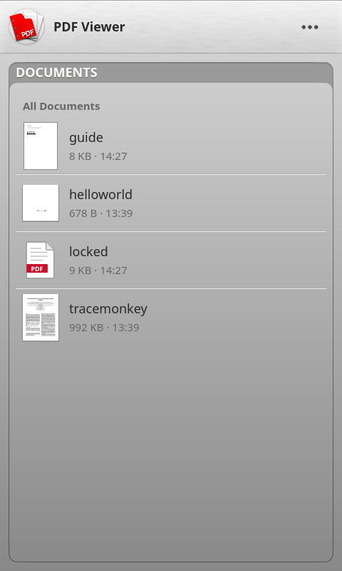

PDF Viewer
==========

Summary
-------
Reads the PDF documents on the device, and any that other apps hand it
(Files, Email, the browser's downloads).

A QML app for LuneOS in the LuneOS style (LuneOS.Forms), drawing pages with
poppler's Qt 6 library. It replaces the Enyo 2 app with pdf.js 1.3 that was
here before: that one found no documents on a device (it asked db8 for
`com.palm.media.misc.file`, which the media indexer never fills), drew one
page at a time on the GUI thread, and was not registered for PDF files.

Screenshots
-----------

From the QML tests on the build host (`tests/run-qml-tests.sh`, luneos-components'
desktop stand-ins, so the fonts are the host's rather than Prelude).

**Phone, 480x800** (mindphone): the library, a page, find, the contents.

| Library | Reading | Find | Contents |
|---|---|---|---|
|  |  |  |  |

**Square, 720x720** (Q25): reading, copying a word, go to page.

| Reading | Copy | Go to Page |
|---|---|---|
|  |  |  |

**Tablet, 1024x768** (HP TouchPad): reading, every page, turned at night,
and the library with how far a document was read.

| Reading | Pages | Turned, night | Recent |
|---|---|---|---|
|  |  |  |  |

Features
--------

- **Library:** every `*.pdf` under `/media/internal` (USB copies, downloads),
  found on a worker thread and again whenever the app comes back to the
  front. The first page of each as its picture (kept in the cache directory,
  so a document is opened once for it). **Recent:** the last five read, with
  how far. Sort by name (numbers by value), date or size; a search box once
  there are six or more. Touch and hold for Open, Send by Email, Remove from
  Recent.
- **Opened from other apps:** appinfo.json's `mimeTypes` registers the app
  for `application/pdf`; `{"target": "<path or file: URL>"}` opens that
  document, in the reader already open.
- **Reading:** the pages one under the other, scrolled as one; each page fits
  the width, or the whole page fits the screen (the key at the right of the
  command menu). **Pinch** or **Ctrl+wheel** to zoom about the fingers,
  **double tap** to zoom in there and again to fit. Zoomed in past what a
  whole page can be drawn at, the part on screen is drawn sharp over it.
  Pages are drawn on two threads as they come into view, and a page
  scrolled past stops drawing.
- **Full screen:** a tap hides the header and the command menu (the legacy
  Full Screen Mode), another brings them back; scrolling hides them too.
  While they are away, a bubble says which page.
- **Command menu:** contents, page before, which page (tap: **Go to Page**,
  by number or by the document's own labels, "xii", with a slider), page
  after, fit width / fit page. **App menu** (and the header's "…"): Go to
  Page, Find, Rotate Clockwise / Counterclockwise, Night Mode, Send by
  Email, Document Info.
- **Contents:** the document's outline, and every page small, from the left.
- **Find:** every match highlighted, the current one stronger; "3 of 17",
  the one before and after, from the page being read on. Case and accents
  ignored, across line ends.
- **Links:** to a page (with "Back to page …" to return), and to the web
  (asked first, then opened by the browser).
- **Copy:** touch and hold a word; drag the handles over more; Copy. Not in
  a document that forbids it.
- **Passwords:** asked for, and asked again when wrong. Kept nowhere.
- **Where the reader was** - page, how far down it, zoom, turn - is kept per
  document and restored on opening it again.
- **Night mode:** the pages inverted, light on dark.
- **Document Info:** title, author, subject, keywords, pages, dates, the
  program and PDF version, protection, the file.
- The back gesture closes what is open first (the selection, the contents,
  find), then goes back to the library. The header's Back does the same for
  devices without a gesture area.

Building
--------

The app needs poppler with its Qt 6 frontend: poppler's `qt6`
PACKAGECONFIG (meta-webos-ports enables it for this app). With the webOS
CMake modules (the recipe) it installs to the applications directory with
its luna-service2 role and permissions; without them (a desktop build) under
the build tree.

    cmake -S . -B build -G Ninja && ninja -C build

The QML is installed as it is; the plugin (`PdfViewerApp/`) is the C++:

- `DocumentRegistry` - the documents open, by an id that stands for them in
  image URLs, and the threads. A poppler document must not be used from two
  threads at once, so each user leases a copy of its own.
- `PdfDocument` - opens a document on a worker; sizes, labels, the outline,
  links, text, the word under a finger, metadata, the password.
- `PageImageProvider` (`image://pdfpage/`), `ThumbnailImageProvider`
  (`image://pdfthumb/`) - pages and parts of pages, and the library's
  pictures, drawn on the render threads and cancelled when no longer
  wanted; `RenderPlan` keeps a page within a pixel budget.
- `DocumentSearch` - the search, page by page on a worker.
- `FileScanner` - the library's documents.

Tests
-----

See [tests/README.md](tests/README.md): unit tests for the C++ (gtest),
QML tests for the helpers and for the app on four screens (1024x768,
720x1280, 480x800, 720x720), static analysis, sanitizers, valgrind and the
six builds (GCC and Clang for armv7, aarch64 and x86-64).

License
-------

GPL version 3, see COPYING. poppler, which draws the pages, is GPL as well.
